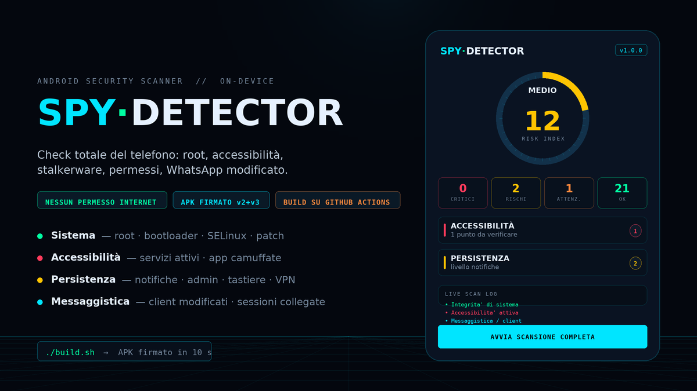

# SpyDetector

**Controlla se il tuo Android è spiato.** Un'analisi completa del telefono in
pochi secondi: punteggio di rischio da 0 a 100 e, per ogni problema, il motivo e
cosa fare.

L'analisi avviene **sul telefono**: nessun dato tuo viene inviato, nessuna
statistica, nessun account. La rete serve solo per due cose che vedi a schermo:
aggiornare l'elenco delle firme ufficiali e proporti una versione nuova dell'app.

<p align="center">
  
</p>

---

## Come si usa

1. **Scarica l'APK** dalla pagina [Releases](../../releases) di questo repository.
2. **Aprilo sul telefono** e consenti *Installa da questa origine*.
3. Apri SpyDetector: la scansione parte da sola. Puoi ripeterla quando vuoi con
   **AVVIA SCANSIONE COMPLETA**.
4. Leggi il risultato: tocca un'area per vedere i dettagli, poi **CONDIVIDI** per
   salvare o inviare il report.

Serve **Android 8.0 o successivo**.

## Cosa trova

| Area | Esempi di cosa controlla |
|---|---|
| **Sistema** | root, bootloader sbloccato, sistema modificato, protezioni kernel disattivate |
| **Configurazione** | blocco schermo, cifratura, aggiornamenti di sicurezza vecchi, debug USB |
| **Accessibilità** | app che possono *leggere lo schermo*: è così che si rubano chat, password e codici |
| **Notifiche e controllo** | chi legge le tue notifiche, chi può impedire la disinstallazione, tastiere e app SMS strane |
| **Spyware noto** | confronto con un elenco di app di sorveglianza conosciute (mSpy, FlexiSPY, Hoverwatch…) |
| **Pattern pubblici** | varianti rinominate e repackaging: corrispondenze con nomi di famiglie, firme (SHA-256) e componenti noti |
| **WhatsApp e Telegram** | versioni modificate (GB WhatsApp, Plus, YoWA…), firma dell'app, come controllare i dispositivi collegati |
| **App installate** | app arrivate fuori dal Play Store, nomi sospetti, permessi pericolosi (SMS + microfono + posizione + fotocamera) |
| **Rete** | VPN e tunnel attivi, proxy impostati |

### Come leggere il punteggio

| Punteggio | Significato |
|---|---|
| **0** | nessun rischio rilevato |
| **1–9** | basso: ci sono dettagli da sistemare |
| **10–24** | medio: qualche impostazione va corretta |
| **25–49** | alto: ci sono app o permessi da verificare subito |
| **50–100** | critico: possibile sorveglianza attiva |

Ogni voce ha una gravità (OK, attenzione, rischio, critico): apri il dettaglio
per vedere **la prova** e **la cosa da fare**.

## Se il risultato non ti convince

- **Non è un antivirus.** Rileva indizi tecnici, non tutto lo spyware esistente.
- Se vedi un'app che non riconosci con accessibilità o lettura notifiche,
  revoca quei permessi e disinstallala.
- In caso di dubbio serio: reset ai dati di fabbrica e cambio password da un
  **altro** dispositivo.
- Su Android 9+ l'elenco dei servizi di accessibilità può essere nascosto alle
  app: SpyDetector lo dice e ti indica dove controllare a mano.

## Privacy

L'analisi è **locale**: nessun account, nessuna pubblicità, nessuna statistica.
L'elenco delle app installate, i permessi e le impostazioni vengono letti solo
sul telefono e non lasciano il dispositivo.

L'app ha il permesso `INTERNET` per due sole funzioni, entrambe verso GitHub ed
entrambe mostrate a schermo mentre girano:

| Cosa fa | Dove | Perché |
|---|---|---|
| scarica `data/official-signatures.txt` | `raw.githubusercontent.com` | riconoscere le app ufficiali con il database aggiornato, senza ricompilare l'APK |
| controlla se esiste una versione nuova e propone di scaricarla | `api.github.com` + Releases | aggiornare l'app senza store |

Sono richieste **GET** che non contengono identificativi del dispositivo né
l'elenco delle app installate. L'unico dato inviato è lo `User-Agent`
(`SpyDetector/<livello API Android>`). Senza rete l'app funziona lo stesso: usa
il database incorporato e salta l'aggiornamento.

## Per chi sviluppa

L'APK si compila senza Android Studio:

```bash
./tools/fetch-toolchain.sh    # scarica gli strumenti di build
./build.sh                    # crea dist/SpyDetector-v<versione>-release.apk
```

Controlli e auto-correzione (gli stessi che girano in CI):

```bash
python3 scripts/gates.py                  # tutti i gate di qualita'
python3 scripts/gates.py --with-build     # + compila l'APK e lo verifica
python3 scripts/autofix.py --dry-run      # cosa verrebbe corretto, senza scrivere
python3 scripts/selfheal.py               # ciclo: gate -> correzione -> gate
python3 scripts/test-selfheal.py          # self-test del meccanismo
```

**Il repository si corregge da solo.** Ogni notte (e ogni volta che una pipeline
fallisce) `self-heal.yml` esegue i gate, applica correzioni deterministiche e
rida i controlli, poi apre una PR che tutta la CI riesamina: se un check
fallisce, il ciclo riparte; se tutto e' verde, `automerge.yml` la unisce e
`release.yml` ricostruisce l'APK. Corregge da solo solo cio' che e' meccanico
(whitespace, import inutilizzati, `permissions:` mancanti, pin delle action,
codice generato non allineato): per tutto il resto apre una issue invece di
inventare una patch. Se una correzione peggiora le cose, viene annullata con
`git reset`.

La repo usa **solo il `GITHUB_TOKEN` di corsa, nessun PAT**. Le conseguenze,
dette per quello che sono: la PR del bot viene creata e il ciclo la fa
verificare, ma i check innescati dalla PR restano in attesa di un'approvazione
umana (`Approve workflows to run`) e il merge lo fa una persona; le modifiche che
toccano `.github/workflows/` non possono proprio essere pushate — il server le
rifiuta, quindi finiscono in una patch allegata alla corsa e in una issue.
Dettagli ed evidenze in [docs/SECURITY.md](docs/SECURITY.md).

Altri script utili:

| script | cosa fa |
|---|---|
| `scripts/release.sh 1.1.0` | aggiorna `VERSION`, pusha e fa pubblicare la release alla CI |
| `scripts/update-threat-db.py` | rigenera `ThreatDbGenerated.java` da `data/threat-seed.txt` (`--check` verifica senza scrivere) |
| `scripts/update-pins.py` | pinna le action GitHub al commit SHA della release compatibile (`--dry-run`, `--check`, `--selftest`) |
| `scripts/update-toolchain.py` | valida e pinna la toolchain di build (npm/PyPI + SHA256) |
| `scripts/check-iocs.py` | indicatori di compromissione dei pacchetti usati per la build |
| `scripts/verify-apk.py` | verifica che l'APK costruito sia installabile e contenga il codice atteso |
| `scripts/make-preview.py` | rigenera `docs/preview.png` |

Dettagli su build, automazione, ciclo di self-healing e controlli di sicurezza:
[docs/SECURITY.md](docs/SECURITY.md).

## Licenza

Uso personale e didattico. Analizza solo dispositivi tuoi o per cui hai
un'autorizzazione esplicita.
