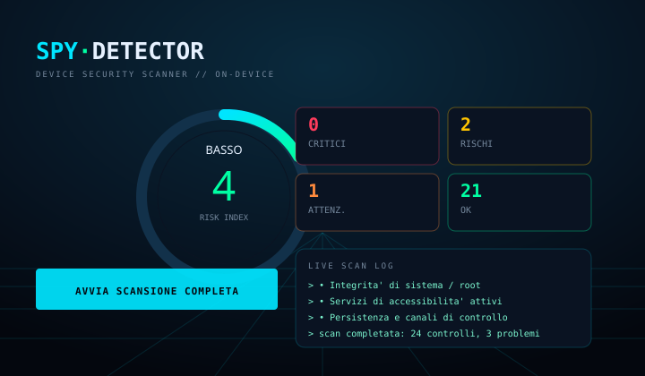

# SpyDetector — Android Device Security Scanner

**APK di release firmato, grafica HUD futuristica, analisi 100% on-device.**
Nessun permesso `INTERNET`: il telefono non manda fuori un solo byte.

<p align="center">
  
</p>

---

## Cosa fa

Un check totale del telefono in pochi secondi, con punteggio di rischio 0-100 e
per ogni problema la **prova tecnica** e **cosa fare**.

| Area | Controlli |
|------|-----------|
| **Sistema** | root (`su`, busybox, Magisk/KernelSU), bootloader sbloccato, Verified Boot (orange), SELinux permissive, `test-keys`, build userdebug |
| **Configurazione** | blocco schermo, cifratura memoria, patch di sicurezza (età in mesi), debug USB, posizione finta |
| **Accessibilità** | servizi di accessibilità attivi — il vettore n.1 per leggere **WhatsApp, chat, OTP e password**; rileva app camuffate (torcia, calcolatrice), combinazione letale *accessibilità + lettura notifiche* |
| **Persistenza** | lettura notifiche, amministratori del dispositivo (bloccano la disinstallazione), tastiere di terze parti, app SMS predefinita, VPN always-on |
| **Stalkerware** | confronto con database locale di kit noti (mSpy, FlexiSPY, Hoverwatch, KidLogger, Spyzie, TheTruthSpy, …) |
| **Messaggistica** | client WhatsApp/Telegram **modificati** (GB WhatsApp, WhatsApp Plus, YoWA, FM, Telegram non ufficiali), firma del pacchetto ufficiale, istruzioni guidate per controllare le *sessioni/dispositivi collegati* (WhatsApp Web, Telegram, Google) |
| **Applicazioni** | app installate fuori dallo store, nomi sospetti, combinazioni di permessi da spyware (SMS + microfono + posizione + fotocamera), servizi di accessibilità dichiarati |
| **Rete** | interfacce tunnel (`tun`/`tap`/`wg`), VPN, proxy HTTP, tipo di connessione |

Output: dashboard con anello di rischio, contatori per gravità, log di scansione
live, schede per area, elenco dettagliato con evidenza + consiglio, e report
testuale condivisibile (WhatsApp, email, note).

## Installazione

1. Scarica l'APK dalla sezione **Releases** di questo repository.
2. Aprilo sul telefono → consenti *Installa da questa origine*.
3. Android 8.0+ (API 26). Firma APK v2+v3.

Verifica del file scaricato:

```bash
sha256sum SpyDetector-v1.0.0-release.apk   # confronta con il .sha256 della release
```

> Play Protect può mostrare un avviso per le app installate da APK: è atteso per
> qualsiasi applicazione fuori dal Play Store. Il codice sorgente è qui, puoi
> ricompilare l'APK da zero con `./build.sh`.

## Compilare da sorgente (senza Android Studio)

Il progetto **non usa Gradle**: `build.sh` usa `aapt2` + `ecj` + `d8` +
`apksigner` e produce un APK di release firmato.

```bash
./tools/fetch-toolchain.sh   # scarica JDK 21, aapt2, d8, ecj, apksigner, android.jar
./build.sh                   # -> dist/SpyDetector-v<version>-release.apk + .sha256
```

Il toolchain viene preso da repository pubblici (npm/PyPI) per funzionare anche
in ambienti senza Android SDK. Tutto finisce in `.toolchain/` (ignorato da git).

Requisiti: `bash`, `curl`, `python3`, `unzip`/`zip`. Tempo di build: ~10 s.

### Test rapido su emulatore/telefono

```bash
adb install -r dist/SpyDetector-v1.0.0-release.apk
adb shell am start -n it.spydetector.app/.MainActivity
```

## Tutto automatizzato su GitHub Actions

Nessun passaggio manuale: **GitHub compila, verifica, attesta e pubblica**.

| Workflow | Quando | Cosa fa |
|---|---|---|
| `ci.yml` | ogni push/PR | actionlint, toolchain pinnato, build, `verify-apk.py`, `apksigner verify`, artifact |
| `release.yml` | tag `v*` o manuale | build → verifica → **SBOM SPDX** → **attestazione di provenienza** → release con APK + SHA256, **eliminando le release precedenti** (una sola versione online) |
| `security-updates.yml` | **ogni giorno 04:17 UTC** | aggiorna action pinnate + toolchain + threat DB, **ricompila e verifica**, scansiona con Trivy/OSV, apre PR solo se tutto passa |
| `codeql.yml` | push/PR + lunedì | CodeQL (Actions) |
| `sast.yml` | push/PR + lunedì | Semgrep sul codice Java/Android, Python, Bash |
| `vulnerability-scan.yml` | push + ogni notte | OSV Scanner + Trivy (vuln, secret, misconfig) |
| `automerge.yml` | PR di aggiornamento | merge automatico **solo se tutti i check sono verdi** |
| `secrets.yml` | push/PR + ogni notte | gitleaks su tutto lo storico |
| `malware-scan.yml` | push + ogni notte | ClamAV sull'APK + check IOC dei pacchetti npm/PyPI |
| `dependency-review.yml` | ogni PR | blocca dipendenze vulnerabili |
| `scorecard.yml` | settimanale | punteggio OpenSSF Scorecard |

Dependabot (`.github/dependabot.yml`) tiene allineate action e dipendenze Python.

### Nuova release (un comando)

```bash
./scripts/release.sh 1.1.0     # VERSION + commit + push + workflow Release
```

La release marcata *Latest* è sempre l'unica versione corrente.

### Sicurezza della catena di build

- toolchain pinnato a **versione + SHA256** (`tools/toolchain.env`), aggiornato
  solo dopo che la nuova versione è stata **scaricata e provata**
  (`scripts/update-toolchain.py`);
- action pinnate al **commit SHA** (`scripts/update-pins.py`);
- APK verificato nel contenuto, non solo nella firma (`scripts/verify-apk.py`);
- IOC di supply chain sui pacchetti usati per la build (`scripts/check-iocs.py`).

Dettagli e limiti: [docs/SECURITY.md](docs/SECURITY.md).

## Struttura

```
app/src/main/java/it/spydetector/app/
├── MainActivity.java        dashboard HUD, scan, condivisione report
├── DetailActivity.java      risultati espandibili per gravità
├── core/                    Engine, Check, Finding, Report, AccessState…
│   ├── ThreatDb.java        lookup                                      (curato)
│   └── ThreatDbGenerated.java  knowledge base                           (generato)
├── checks/                  9 moduli di analisi (uno per area)
├── ui/                      HudBackground, RiskGauge, Ui
└── util/Sys.java
data/threat-seed.txt         knowledge base stalkerware (fonte primaria)
tools/toolchain.env          versioni + SHA256 del toolchain (generato/validato)
tools/fetch-toolchain.sh     download toolchain con verifica hash
build.sh                     build + firma APK di release
scripts/
├── release.sh               nuova release via GitHub Actions
├── update-toolchain.py      trova, prova e pinna la toolchain più recente
├── update-pins.py           pin delle action (solo major compatibili)
├── update-threat-db.py      rigenera + valida la knowledge base
├── verify-apk.py            verifica che l'APK funzioni davvero
└── check-iocs.py            IOC della supply chain di build
.github/workflows/           ci, release, security-updates, codeql, secrets, malware, deps, scorecard
```

## Limiti (dichiarati, non nascosti)

- Da Android 9+ l'elenco dei servizi di accessibilità attivi può non essere
  leggibile da un'app normale: in quel caso l'app lo dice e indica il percorso
  manuale (`Impostazioni → Accessibilità`) invece di inventare un risultato.
- Il database stalkerware è un **sottoinsieme curato**: una variante con nome
  pacchetto modificato non viene riconosciuta dal nome. Per questo contano i
  controlli su permessi, accessibilità e notifiche, che sono comportamentali.
- Non è un antivirus: rileva **indicatori tecnici**. Non sostituisce un reset di
  fabbrica né una perizia forense.
- Non è possibile intercettare traffico cifrato di altre app né leggere i
  contenuti dei messaggi di WhatsApp: e nessuna app onesta lo promette.

## Privacy

Nessun permesso di rete, nessun analytics, nessun SDK di terze parti, nessuna
raccolta dati. `QUERY_ALL_PACKAGES` serve solo a elencare in locale le app
installate per l'audit.

## Firma dell'APK

La chiave di release è in `signing/spydetector-release.jks` (password
`spydetector`, alias `spydetector`). **Non è un segreto sicuro**: se pubblichi
l'app, sostituisci la chiave e conservala offline. Per firmare con un'altra
chiave:

```bash
SPD_KS_PASS=... SPD_KEY_ALIAS=... SPD_KEY_PASS=... ./build.sh
```

Certificato attuale:

```
CN=SpyDetector, O=SpyDetector, C=IT
SHA-256: B7:F3:6F:1B:24:33:29:10:CF:5C:A4:99:DB:BB:8C:4F:B4:27:96:F7:38:A9:AA:C4:70:6A:09:72:7B:0D:5A:6B
```

## Licenza

Uso personale/didattico. Sei responsabile dell'uso: analizza solo dispositivi
tuoi (o per cui hai autorizzazione esplicita).
